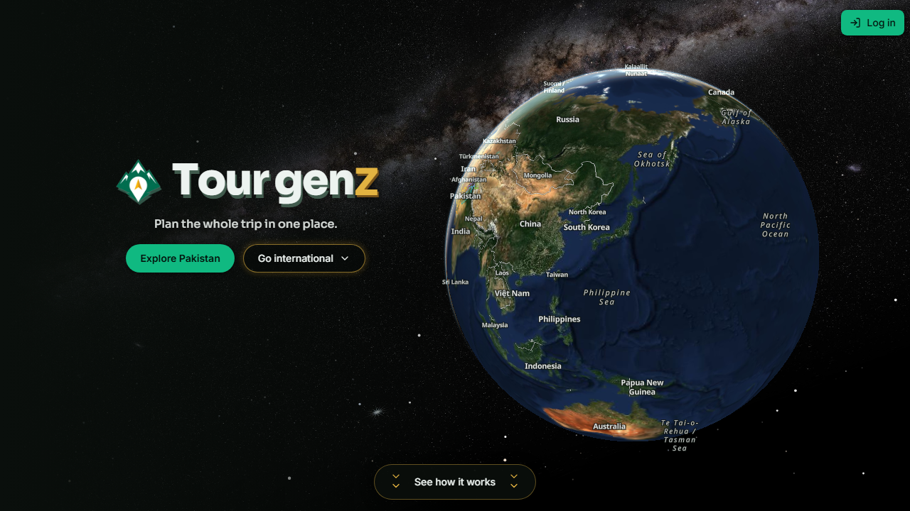

<!-- HAFIZ MUHAMMAD HARIS · GitHub profile README. Fill every PASTE_LINK_HERE. -->

<table>
  <tr>
    <td align="center" width="230"> <b>Now</b> · Core engineer on <a href="https://tourgenz.com">Tourgenz</a> Web7Labs, July 2026 → present</td>
    <td align="center" width="230"> <b>BS Software Engineering</b> University of Lahore · 2027</td>
    <td align="center" width="230"> <b>Lahore, Pakistan</b> Open to remote</td>
    <td align="center" width="230"> <b>Backend · AI · Scraping</b> Data pipelines at scale</td>
  </tr>
</table>

<!-- ===================== STACK ===================== -->
<h3 align="center">🧰 Stack</h3>
<table align="center">
  <tr>
    <td align="center" width="50%"><b>Languages</b> </td>
    <td align="center" width="50%"><b>Frontend</b> · + Zustand, React Query, Framer Motion </td>
  </tr>
  <tr>
    <td align="center"><b>Backend</b> · + REST, SQLAlchemy, AsyncIO, Zod, JWT, SSE </td>
    <td align="center"><b>Databases</b> · + PostGIS, pgvector </td>
  </tr>
  <tr>
    <td align="center"><b>Automation</b> · + Playwright, Puppeteer, curl_cffi TLS impersonation &nbsp; </td>
    <td align="center"><b>AI & Platforms</b> · + Railway, Cloudinary, Streamlit, VPS     </td>
  </tr>
</table>

<!-- ===================== EXPERIENCE ===================== -->
<h3 align="center">💼 Experience</h3>
<table align="center">
  <tr>
    <td width="50%" valign="top">
      <table><tr>
        <td width="56" valign="middle"></td>
        <td valign="middle"><b>Web7Labs · Full-Stack Software Engineer</b> Jul 2026 → now · Lahore</td>
      </tr></table>
        
      • Core engineer on <a href="https://tourgenz.com">Tourgenz</a>: traveller app, 5 vendor portals, admin control room. 
      • Client Hunt: crash-resilient Google Maps lead tool, SQLite dedup, 1-click Excel/CSV.
    </td>
    <td width="50%" valign="top">
      <table><tr>
        <td width="56" valign="middle"></td>
        <td valign="middle"><b>BitBash · Software Engineering Intern</b> May → Jul 2026 · Lahore</td>
      </tr></table>
        
      • Instagram lead platform: automated discovery → export, thousands of leads daily. 
      • Cloudflare-resistant Upwork scraper with Discord alerts; ChatGPT SEO pipeline on a VPS.
    </td>
  </tr>
</table>

<!-- ===================== PROJECTS ===================== -->
<h3 align="center">🚀 Projects</h3>
<table align="center">
  <tr>
    <td width="38%" align="center" valign="middle">
      
    </td>
    <td width="62%" valign="top">
      <b>🌍 Tourgenz · AI tourism & booking marketplace</b> 
      
      <!-- PASTE_LINK_HERE: Tourgenz repo, if public -->
      
       
      • 🧾 Offer-your-price booking, one tested status path, wallet ledger with holds and audit trail. 
      • 🤖 AI planner and chat restricted to real, bookable listings. 
      • 🛰️ Zero-API-key 3D satellite globe: 493 destinations, 8,445 PostGIS grid cells with AI insights. 
      • 🔐 Auth from scratch (in-memory tokens, rotating httpOnly cookies, reuse detection, 5 roles) · ~2,000 tests · 111 SQL migrations.
    </td>
  </tr>
</table>
<table align="center">
  <tr>
    <td width="50%" valign="top">
      <b>📸 Instagram Lead Generator</b>
      <!-- PASTE_LINK_HERE: repo -->
      <!-- PASTE_LINK_HERE: demo --> 
      
        
      Async discovery → qualification → export; ~25 rotating proxies with TLS impersonation; JWT dashboard with live KPIs and streaming CSV.
    </td>
    <td width="50%" valign="top">
      <b>🧠 Upwork Job Intelligence & SEO Publisher</b>
      <!-- PASTE_LINK_HERE: repo -->
      <!-- PASTE_LINK_HERE: public site --> 
      
        
      Reverse-engineered GraphQL scraping; ChatGPT filtering and SEO generation via Puppeteer; two Postgres DBs synced by watermark cron.
    </td>
  </tr>
  <tr>
    <td valign="top">
      <b>🎓 TransGPA · Transcript analyzer & CGPA simulator</b>
      <!-- PASTE_LINK_HERE: repo -->
      <!-- PASTE_LINK_HERE: demo --> 
      
        
      Privacy-first: PDFs parsed in the browser, zero server storage; real-time GPA simulation on Recharts.
    </td>
    <td valign="top">
      <b>🎮 Khilariverse · Gaming peripherals store</b>
      <!-- PASTE_LINK_HERE: repo -->
      <!-- PASTE_LINK_HERE: demo --> 
      
        
      Full MERN store with role-based access, sales and inventory analytics, Cloudinary images, transactional email.
    </td>
  </tr>
</table>

<!-- ===================== STATS ===================== -->

  
  
  
   
  

